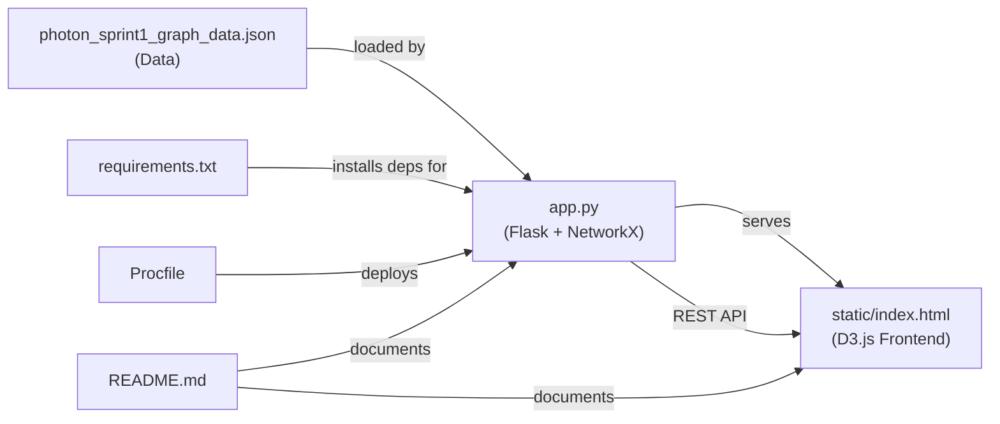

# DynamicGraph — File-by-File Breakdown

This folder contains a **Supply-Chain Graph Visualization** app (Team Photon, Sprint 1). It models a Directed Acyclic Graph (DAG) of **Suppliers → Parts → Products → Orders** and lets users interactively explore, delete, undo, and trace dependencies.

---

## 📁 File Structure

```
DynamicGraph/
├── app.py                              ← Python backend (Flask + NetworkX)
├── photon_sprint1_graph_data.json      ← Supply-chain dataset (19 nodes, 21 edges)
├── requirements.txt                    ← Python dependencies
├── Procfile                            ← Heroku deployment descriptor
├── README.md                           ← Project documentation
└── static/
    └── index.html                      ← Full frontend (HTML + CSS + D3.js)
```

---

## 1. [`app.py`](file:///c:/Users/Ansh/Downloads/EPAM-SPRINTS/EPAM-SPRINTS/DynamicGraph/app.py) — Flask Backend Server

**Purpose:** The Python backend that builds the supply-chain graph in memory using **NetworkX** and exposes a REST API consumed by the D3.js front-end.

| What it does | Detail |
|---|---|
| **Loads graph data** | Reads `photon_sprint1_graph_data.json` on startup and builds a `nx.DiGraph` with all nodes (suppliers, parts, products, orders) and directed edges (SUPPLIES, USED_IN, FULFILLS). |
| **Serves the front-end** | `GET /` serves `static/index.html`. |
| **Full graph API** | `GET /api/graph` returns all nodes and edges as JSON (D3-friendly format). |
| **Downstream trace** | `GET /api/downstream/<node_id>` runs BFS via `nx.descendants()` to find all nodes reachable downstream from a given node. |
| **Impact preview** | `GET /api/impact/<node_id>` shows what *would* happen if a node were deleted — affected nodes, edges to remove, and O(V+E) complexity info — without actually deleting. |
| **Delete with cascade** | `DELETE /api/node/<node_id>` removes a node plus its entire downstream cascade, saves a snapshot for undo, and returns timing/complexity metrics. |
| **Undo** | `POST /api/undo` restores the graph to its state before the last delete (pops from an undo stack of deep-copied snapshots). |
| **Reset** | `POST /api/reset` rebuilds the graph from the original JSON and clears undo history. |

> [!NOTE]
> The graph lives entirely in memory (global `GRAPH` variable). There's no database — restarting the server resets everything.

---

## 2. [`photon_sprint1_graph_data.json`](file:///c:/Users/Ansh/Downloads/EPAM-SPRINTS/EPAM-SPRINTS/DynamicGraph/photon_sprint1_graph_data.json) — Supply-Chain Dataset

**Purpose:** The canonical data file defining the entire supply-chain graph topology.

| Section | Content |
|---|---|
| **`metadata`** | Project name, graph type (DAG), summary counts (19 nodes, 21 edges). |
| **`nodes.suppliers`** (2) | `SUP-01` (Apex Components, Pune) and `SUP-02` (Bharat Precision Parts, Indore). |
| **`nodes.parts`** (5) | Control Board, Battery Cell Pack, Motor Assembly, Casing, Wiring Harness — each with `stock_on_hand`, `daily_consumption`, and `days_of_supply`. |
| **`nodes.products`** (2) | Smart Controller Unit (PROD-01) and Motor Drive Unit (PROD-02), with BOM references. |
| **`nodes.orders`** (10) | ORD-01 through ORD-10, each linked to a customer, product, quantity, and deadline. |
| **`edges.supplies`** (6) | Which supplier provides which parts, with `lead_time_hours` and `max_capacity_units_per_day`. |
| **`edges.used_in`** (5) | Which parts go into which products, with `quantity_per_unit`. |
| **`edges.fulfills`** (10) | Which products fulfill which customer orders. |

> [!IMPORTANT]
> This is the single source of truth for the graph. Both the backend (`app.py`) and the README reference its exact counts for test oracles.

---

## 3. [`requirements.txt`](file:///c:/Users/Ansh/Downloads/EPAM-SPRINTS/EPAM-SPRINTS/DynamicGraph/requirements.txt) — Python Dependencies

**Purpose:** Declares the three Python packages needed to run the backend.

```
flask==3.1.1          # Web framework for the REST API
networkx==3.4.2       # Graph library for DAG construction, BFS traversal, cascade deletion
gunicorn>=22.0.0      # Production WSGI server (used by the Procfile for deployment)
```

> [!TIP]
> For local development you only need Flask and NetworkX (`python app.py` uses Flask's built-in server). Gunicorn is only used in production/Heroku.

---

## 4. [`Procfile`](file:///c:/Users/Ansh/Downloads/EPAM-SPRINTS/EPAM-SPRINTS/DynamicGraph/Procfile) — Heroku Deployment Descriptor

**Purpose:** Tells Heroku (or any Procfile-aware PaaS) how to start the application.

```
web: gunicorn app:app
```

- **`web:`** — declares a web process type.
- **`gunicorn app:app`** — launches Gunicorn pointing at the `app` Flask object inside `app.py`.

> [!NOTE]
> This file is only relevant for cloud deployment. Locally, you run `python app.py` which starts Flask's development server on port 5000.

---

## 5. [`README.md`](file:///c:/Users/Ansh/Downloads/EPAM-SPRINTS/EPAM-SPRINTS/DynamicGraph/README.md) — Project Documentation

**Purpose:** Comprehensive project documentation for the "IntelliTwin" supply-chain digital twin.

| Section | What it covers |
|---|---|
| Overview & Key Capabilities | All UI features — dynamic graph generator, hover path highlighting, sidebars, KPI cards, traversal benchmarks, reachable orders |
| Technology Stack | React 19, TypeScript, Vite, Tailwind, @xyflow/react, Redux Toolkit, TanStack Query, Axios, Recharts, Vitest |
| Application Structure | Full `frontend/src/` directory tree with API layer, components, mocks, pages, services, store, tests, types |
| Getting Started | Install, run dev, run tests, production build |
| Test Matrix | 19 automated tests with exact reachability oracles for SUP-01 and SUP-02 |
| FastAPI Integration | Describes the `VITE_DATA_MODE=mock|live` environment variable for switching between mock data and a real API |

> [!WARNING]
> The README describes a much larger React/TypeScript frontend (`frontend/` directory) that does **not** exist in this folder. This `DynamicGraph/` folder contains only the **Flask + D3.js prototype**. The README likely documents a parallel or planned frontend implementation.

---

## 6. [`static/index.html`](file:///c:/Users/Ansh/Downloads/EPAM-SPRINTS/EPAM-SPRINTS/DynamicGraph/static/index.html) — Full Frontend (Single-Page App)

**Purpose:** A self-contained ~62 KB HTML file that is the entire interactive front-end. It includes inline CSS + JavaScript and uses **D3.js** (loaded via CDN) to render the graph.

| Aspect | Detail |
|---|---|
| **Styling** | ~780 lines of CSS with a dark glassmorphism theme, category-specific colors (supplier=pink, part=amber, product=teal, order=blue), glow effects, smooth transitions. |
| **Layout** | Header bar with Undo/Reset buttons → main SVG graph canvas → bottom output panel with impact preview and action log. |
| **Graph Rendering** | Uses D3.js v7 to fetch `/api/graph`, then renders nodes as circles in a 4-column layout (Suppliers → Parts → Products → Orders) with curved bezier edge lines and arrowhead markers. |
| **Interactivity** | Hover highlighting (dims unrelated nodes/edges), click to select a node (opens side info panel with all attributes), click to delete (shows confirmation modal with impact preview from `/api/impact/<id>`). |
| **Bottom Panel** | Two-column dock: (1) **Impact Preview** showing cascade details before/after deletion, and (2) **Action Log** recording delete/undo/reset history with timestamps and performance metrics. |
| **Undo Timing Popup** | After an undo, a 5-second floating popup shows restoration metrics (nodes restored, edges restored, delete time, undo time, complexity). |
| **Toasts** | Transient notification toasts for delete/undo/reset confirmations. |
| **API Integration** | Fetches from `GET /api/graph`, `GET /api/impact/<id>`, `DELETE /api/node/<id>`, `POST /api/undo`, `POST /api/reset` — all served by `app.py`. |

---

## How They All Fit Together


