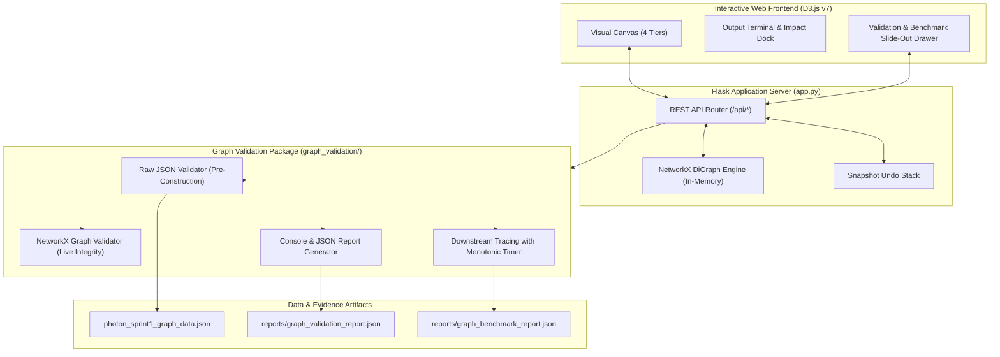

# Team Photon — Proactive Supply-Chain Decision, Ripple & Recovery Intelligence System

> **Team:** LNCT Photon  
> **Component:** Sprint 1 — Directed Supply-Chain Dependency Graph Validation, Downstream Tracing Benchmarking & Interactive Visualization  
> **Technology Stack:** Python 3.12+, Flask 3.1.1, NetworkX 3.4.2, pytest 9.2.0, D3.js v7, HTML5/CSS3

---

## 1. Project Overview & Problem Statement

Global discrete manufacturing supply chains face frequent disruptions: supplier delays, part shortages, transportation bottlenecks, and production halts. When a single supplier fails, the ripple effect cascades down through sub-assemblies to finished products, jeopardizing customer delivery deadlines.

**Team Photon** builds an intelligence platform for proactive supply-chain decision-making. **Sprint 1** implements the foundational **directed dependency graph model**, downstream reachability tracing, cascading deletion impact simulation, and a formal **Graph Structure Validation & Performance Benchmarking Module**.

### Core Objectives
1. **Model Discrete Manufacturing Dependencies**: Represent the strict four-tier supply chain:
   $$\text{Tier-1 Suppliers} \longrightarrow \text{BOM Parts} \longrightarrow \text{Finished Products} \longrightarrow \text{Customer Orders}$$
2. **Enforce Graph Structural Integrity & Acyclicity**: Validate baseline counts, schema types, endpoint existence, tier direction flow, and DAG properties (preventing physical/computational loops).
3. **Sub-10 Millisecond Downstream Tracing**: Benchmark downstream reachability traversal using high-resolution monotonic timers to prove traversal latency completes in **strictly under 10 ms**.
4. **Interactive D3.js Visualization**: Enable real-time node inspection, ripple highlighting, cascading impact preview, snapshot undo, reset, and an integrated UI validation drawer.

---

## 2. Architecture & Technology Stack



### Technology Stack
- **Backend Framework**: Flask 3.1.1
- **Graph Algorithms Engine**: NetworkX 3.4.2
- **Data Serialization**: Standard JSON, Python `dataclasses`
- **Frontend Visualization**: D3.js v7, Vanilla JavaScript, CSS3 Glassmorphism
- **Automated Testing**: pytest 9.2.0, pytest-cov 7.1.0 (73 test cases, 91% coverage)
- **Code Quality & Linting**: Ruff 0.17.3
- **Timer Resolution**: Monotonic `time.perf_counter_ns()`

---

## 3. Graph Model, Categories & Baseline Counts

The canonical Sprint 1 dataset (`photon_sprint1_graph_data.json`) defines an exact baseline:

### Node Categories (19 Total)
| Tier | Entity Category | ID Pattern | Expected Count | Description |
|:---:|---|---|---:|---|
| **1** | **Suppliers** | `SUP-01`, `SUP-02` | **2** | Tier-1 electronics & mechanical vendors (Pune, Indore) |
| **2** | **BOM Parts** | `PART-01` to `PART-05` | **5** | Components with inventory, consumption & days of supply |
| **3** | **Finished Products** | `PROD-01`, `PROD-02` | **2** | Smart Controller Unit & Motor Drive Unit |
| **4** | **Customer Orders** | `ORD-01` to `ORD-10` | **10** | Customer purchase orders with quantities & deadlines |

### Edge Relationships (21 Total)
| Relation Category | Relation Tag | Source Tier → Target Tier | Expected Count |
|---|---|---|---:|
| `supplies` | `SUPPLIES` | Supplier $\to$ Part | **6** |
| `used_in` | `USED_IN` | Part $\to$ Finished Product | **5** |
| `fulfills` | `FULFILLS` | Finished Product $\to$ Customer Order | **10** |

### Agreed Dependency Flow
$$\text{Supplier} \xrightarrow{\text{SUPPLIES}} \text{Part} \xrightarrow{\text{USED_IN}} \text{Product} \xrightarrow{\text{FULFILLS}} \text{Order}$$

---

## 4. Repository Structure

```text
DynamicGraph/
├── app.py                                    # Flask backend API with NetworkX and validation routes
├── photon_sprint1_graph_data.json          # Canonical Sprint 1 supply-chain graph dataset
├── requirements.txt                          # Python dependencies (runtime + testing/linting)
├── README.md                                 # Main project overview and entry point
├── pytest.ini                                # Pytest testpaths, pythonpath, and test discovery
├── pyproject.toml                            # Ruff linter and project configuration
├── .gitignore                                # Git exclusion rules
├── static/
│   └── index.html                            # Interactive D3.js frontend with validation panel
├── index.html                                # Root synchronized frontend entry point
├── graph_validation/                         # Graph Structure Validation Package
│   ├── __init__.py                           # Public exports
│   ├── schema.py                             # Dataclasses, validation policies, and reports
│   ├── validator.py                          # Pre-construction raw validation & live DiGraph checks
│   ├── tracing.py                            # Downstream reachability tracing with nanosecond metrics
│   └── reporting.py                          # Console report formatting & JSON serialization
├── benchmarks/                               # Performance Benchmarking Suite
│   ├── __init__.py                           # Benchmarks package
│   ├── benchmark_tracing.py                  # Traversal latency benchmark runner (p95 < 10 ms)
│   └── README.md                             # Benchmark methodology and execution options
├── reports/                                  # Evidence Reports Directory
│   ├── .gitkeep                              # Directory marker
│   ├── graph_validation_report.json          # Live generated baseline validation report
│   └── graph_benchmark_report.json           # Live generated 2,000-iteration benchmark measurements
├── docs/                                     # Comprehensive Technical Documentation
│   ├── SETUP_GUIDE.md                        # Step-by-step setup guide for Windows/Linux/macOS
│   ├── INTEGRATION_GUIDE.md                  # Backend architecture, Flask routes, and rollback guide
│   ├── FRONTEND_VALIDATION_GUIDE.md          # UI architecture, D3.js interaction, and testing steps
│   ├── GRAPH_SCHEMA.md                       # Domain entities, required fields, and DAG physical rationale
│   ├── TESTING_AND_BENCHMARKING.md           # Test suite details, coverage, and latency benchmarking
│   └── ACCEPTANCE_CHECKLIST.md               # Evidence traceability matrix for AC-01 through AC-11
└── tests/                                    # Automated Pytest Suite (73 Tests)
    ├── conftest.py                           # Isolated fixtures & Flask client state cleanup
    ├── test_node_counts.py                   # Node count & configurable baseline tests
    ├── test_edge_integrity.py                # Edge count & endpoint reference tests
    ├── test_edge_direction.py                # Supply-chain tier direction tests
    ├── test_duplicate_ids.py                 # Pre-construction raw duplicate ID tests
    ├── test_missing_entities.py              # Missing field & schema attribute tests
    ├── test_malformed_data.py                # Non-dict, empty graph & JSON export tests
    ├── test_acyclicity.py                    # Conditional DAG & cycle detection tests
    ├── test_tracing.py                       # Exact supplier reachability & metrics tests
    ├── test_reporting.py                     # Console formatting & report save tests
    ├── test_api_integration.py               # Live Flask endpoint & lifecycle integration tests
    └── test_frontend_validation_contract.py  # Frontend JSON schema contract tests
```

---

## 5. Prerequisites & Environment Setup

### Prerequisites
- Python 3.10+ (Verified on Python 3.12.14 / 3.13.7).
- PowerShell (Windows) or Bash/Zsh (Linux/macOS).

### Installation (Windows PowerShell)

```powershell
# 1. Open directory
cd "d:\EPAM MVP-1\EPAM-SPRINTS-main\DynamicGraph"

# 2. Create virtual environment
python -m venv .venv

# 3. Activate virtual environment
.\.venv\Scripts\Activate.ps1
# (If blocked by PowerShell script policy, run: Set-ExecutionPolicy -Scope Process -ExecutionPolicy Bypass)

# 4. Install dependencies
pip install -r requirements.txt

# 5. Verify installation
python -c "import flask, networkx, pytest; print('Environment Verified OK')"
```

---

## 6. Starting the Application

```powershell
python app.py
```

- **Application URL**: [http://127.0.0.1:5000](http://127.0.0.1:5000) or [http://localhost:5000](http://localhost:5000)
- The Flask backend validates `photon_sprint1_graph_data.json` at startup before constructing the live graph.

---

## 7. Available REST API Endpoints

| Method | Endpoint | Query Parameters | Description | Status Code |
|---|---|---|---|:---:|
| `GET` | `/` | — | Serves the interactive D3.js visualization. | 200 |
| `GET` | `/api/graph` | — | Returns full graph as `{nodes: [...], edges: [...]}`. | 200 |
| `GET` | `/api/validation` | `mode=baseline\|integrity`, `strict=true\|false` | Validates graph structure and returns structured report. | 200 / 422 |
| `GET` | `/api/benchmark/tracing` | `node_id=SUP-01`, `threshold_ms=10.0` | Measures traversal latency and returns nanosecond metrics. | 200 |
| `GET` | `/api/downstream/<id>` | — | Returns all reachable descendant IDs from `<id>`. | 200 |
| `GET` | `/api/impact/<id>` | — | Returns cascading deletion impact preview for `<id>`. | 200 / 404 |
| `DELETE` | `/api/node/<id>` | — | Cascading deletes node and descendants; pushes undo snapshot. | 200 / 404 |
| `POST` | `/api/undo` | — | Restores latest deletion snapshot. | 200 / 400 |
| `POST` | `/api/reset` | — | Rebuilds canonical 19-node graph from source JSON. | 200 |

---

## 8. Validation, Testing & Benchmarking Commands

### Automated Test Suite
```powershell
# Run all 73 tests
pytest -v

# Run with test coverage report
pytest --cov=graph_validation --cov-report=term-missing
```
*Current Result: 73 passed in 0.70s; 91% code coverage.*

### Code Linting
```powershell
ruff check .
```
*Current Result: All checks passed!*

### Traversal Latency Benchmark (< 10 ms Target)
```powershell
python -m benchmarks.benchmark_tracing
```

#### Measured Benchmark Results (2,000 Runs)
- **Min Latency**: `0.0106 ms`
- **Mean Latency**: `0.0166 ms`
- **Median (p50)**: `0.0140 ms`
- **95th Percentile (p95)**: **`0.0366 ms`** (Target: $< 10.0\text{ ms}$)
- **Max Latency**: `0.1618 ms`
- **Status**: **PASS** ($0.0366\text{ ms} \ll 10.0\text{ ms}$, surpassing target by $> 270\times$).

---

## 9. Baseline Validation vs. Live Structural Integrity

- **Baseline Mode (`mode="baseline"`)**: Enforces exact canonical counts: 19 nodes (2 sup, 5 part, 2 prod, 10 ord) and 21 edges. Used to verify the original Sprint 1 dataset.
- **Integrity Mode (`mode="integrity"`)**: Enforces internal structural consistency (valid endpoints, direction rules, acyclicity) without failing due to legitimate node deletion.
- **Adaptive Auto-Detection**: `/api/validation` automatically runs in `baseline` mode when 19 nodes are present, and dynamically switches to `integrity` mode after node deletion.

---

## 10. Current Limitations & Future Improvements

### Current Limitations
1. **In-Memory State**: Graph modifications (deletions, undo) are stored in server memory; restarting Flask reloads the canonical JSON dataset.
2. **Single-Tenant Graph**: Undo stack and graph mutations are shared across connected client sessions.
3. **Sprint 1 Boundary**: Focuses on structural integrity, reachability, and impact preview. It does not perform multi-objective linear programming or financial risk forecasting.

### Future Improvements
1. **Multi-Session Isolation**: Session-isolated graphs using tokenized state or Redis backing.
2. **Dynamic Entity CRUD**: UI-driven creation of custom suppliers, parts, and orders.
3. **Automated Recovery Planning**: Alternative supplier routing and inventory reallocation algorithms for Sprint 2.

---

## 11. Detailed Documentation Links

- **Setup & Installation**: [`docs/SETUP_GUIDE.md`](docs/SETUP_GUIDE.md)
- **Integration Architecture**: [`docs/INTEGRATION_GUIDE.md`](docs/INTEGRATION_GUIDE.md)
- **Frontend Validation UI Guide**: [`docs/FRONTEND_VALIDATION_GUIDE.md`](docs/FRONTEND_VALIDATION_GUIDE.md)
- **Graph Schema & DAG Rationale**: [`docs/GRAPH_SCHEMA.md`](docs/GRAPH_SCHEMA.md)
- **Testing & Benchmarking Specification**: [`docs/TESTING_AND_BENCHMARKING.md`](docs/TESTING_AND_BENCHMARKING.md)
- **Acceptance Criteria Verification Matrix**: [`docs/ACCEPTANCE_CHECKLIST.md`](docs/ACCEPTANCE_CHECKLIST.md)
- **Generated Validation Report**: [`reports/graph_validation_report.json`](reports/graph_validation_report.json)
- **Generated Benchmark Report**: [`reports/graph_benchmark_report.json`](reports/graph_benchmark_report.json)
- **Standalone Archive**: [`team_photon_validation_module.zip`](team_photon_validation_module.zip)

