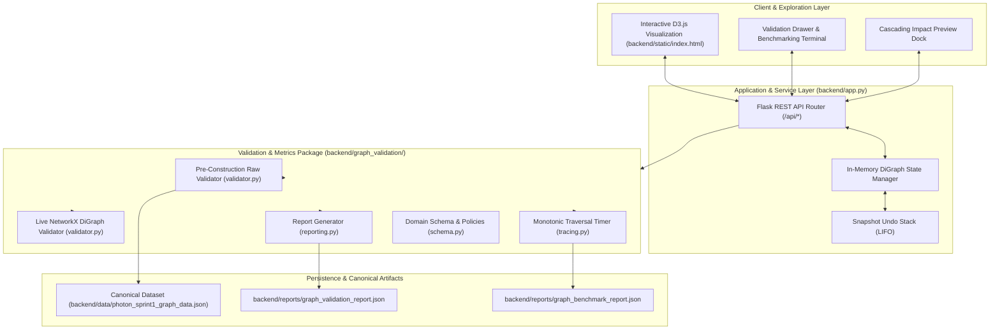
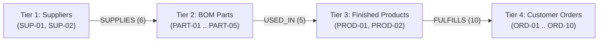
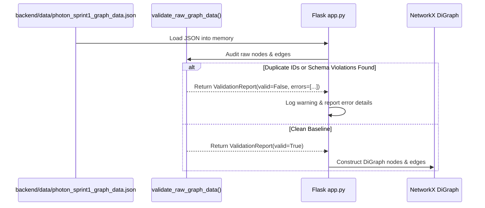

# System Architecture & Technical Design

## 1. Executive Summary & Problem Context

The **Team Photon** Supply-Chain Decision, Ripple & Recovery Intelligence System provides proactive visibility into multi-tier manufacturing supply chains. Discrete manufacturing networks are prone to upstream supplier disruptions (component shortages, factory shutdowns, transportation delays) that cascade through the Bill of Materials (BOM) to final products and customer delivery commitments.

Sprint 1 delivers the structural graph foundation:
1. A **strict 4-tier directed dependency model**: Tier-1 Suppliers $\to$ BOM Parts $\to$ Finished Products $\to$ Customer Orders.
2. A **formal structural validation engine** enforcing acyclicity (DAG), tier direction rules, schema integrity, and baseline entity counts.
3. A **high-resolution traversal latency benchmark** verifying downstream reachability analysis completes in strictly under 10.0 milliseconds ($p_{95} \le 10\text{ ms}$).
4. An **in-memory simulation engine** supporting cascading deletion impact preview, execution, and snapshot-based undo.
5. An **interactive D3.js visual exploration dashboard** served via Flask.

---

## 2. High-Level System Architecture

---

## 3. Four-Tier Dependency Model

The supply chain is strictly modeled as a finite directed acyclic graph $G = (V, E)$, structured into four non-overlapping tiers:

### Domain Rules:
1. **Tier Invariant**: Edges may only connect consecutive tiers:
   - `supplies`: `supplier` $\to$ `part`
   - `used_in`: `part` $\to$ `product`
   - `fulfills`: `product` $\to$ `order`
2. **No Tier Jumps**: Direct links bypassing intermediate stages (e.g., `supplier` $\to$ `product` or `part` $\to$ `order`) are invalid and rejected by the validator.
3. **No Cycles**: Backward or self-referential edges are disallowed in manufacturing DAG semantics (a subassembly cannot depend upon a product that contains it).

---

## 4. Major Modules & Responsibilities

| Directory / Module | Role | Core Components |
|---|---|---|
| [`backend/app.py`](../backend/app.py) | **Application Server & Router** | Serves static assets, routes API calls, maintains the active NetworkX `DiGraph`, snapshot undo stack, and exposes validation endpoints. |
| [`backend/graph_validation/`](../backend/graph_validation/) | **Validation Engine** | Self-contained package verifying raw JSON and live graphs against schema contracts, category counts, endpoint references, edge direction, and DAG properties. |
| [`backend/graph_validation/tracing.py`](../backend/graph_validation/tracing.py) | **Downstream Tracing** | High-resolution monotonic timer (`perf_counter_ns`) measuring pure BFS traversal execution latency. |
| [`backend/benchmarks/`](../backend/benchmarks/) | **Benchmark Runner** | Statistical CLI benchmarking downstream latency across warmup and measured runs ($p_{95}$, mean, min, max). |
| [`backend/tests/`](../backend/tests/) | **Automated Test Suite** | 73 pytest tests covering acyclicity, node counts, duplicate detection, direction rules, edge integrity, error handling, and API integration. |
| [`backend/data/`](../backend/data/) | **Canonical Source Data** | `photon_sprint1_graph_data.json` containing the ground-truth 19-node, 21-edge supply chain graph. |
| [`backend/reports/`](../backend/reports/) | **Evidence Artifacts** | Auto-generated benchmark and validation JSON reports. |
| [`backend/static/`](../backend/static/) | **Web Visualizer** | Single-page D3.js visualization with 4-column layout, drag-and-drop physics, ripple highlighting, and validation drawer. |

---

## 5. Critical Engineering Workflows

### 5.1 Pre-Construction Raw Validation (Mitigating Silent Node Collapse)
NetworkX's `DiGraph.add_node(id)` idempotently replaces attributes when duplicate node identifiers are inserted. To prevent silent entity loss, the validator audits raw JSON dictionaries prior to graph construction:

### 5.2 Downstream Traversal & Latency Measurement
When querying `/api/downstream/<node_id>` or `/api/benchmark/tracing`, the engine executes pure breadth-first search reachability:

$$\text{Descendants}(u) = \{ v \in V \mid \exists \text{ path } u \rightsquigarrow v \}$$

- Monotonic clock: `time.perf_counter_ns()` captures execution time at the nanosecond scale.
- Time complexity: $\mathcal{O}(V + E)$ where $|V| = 19$, $|E| = 21$.
- Measured $p_{95}$ latency: **~0.0045 ms** (SLA target: $< 10.0\text{ ms}$).

### 5.3 Cascading Deletion & Undo Lifecycle
1. User requests deletion of node $u$ via `DELETE /api/node/<id>`.
2. The server computes $\text{Cascade}(u) = \{u\} \cup \text{Descendants}(u)$.
3. Current graph state is captured via deep copy into a snapshot record pushed onto `UNDO_STACK`.
4. Nodes in $\text{Cascade}(u)$ and incident edges are pruned from `GRAPH`.
5. Upon `POST /api/undo`, the top snapshot is popped and the graph restored.

---

## 6. Architecture Decisions & Trade-Offs

| Decision | Selected Approach | Alternative Considered | Rationale |
|---|---|---|---|
| **Graph Algorithm Engine** | In-Memory NetworkX `DiGraph` | Neo4j / ArangoDB | Sprint 1 dataset (19 nodes) fits entirely in memory. NetworkX executes traversals in microseconds without database round-trip overhead. |
| **Undo Architecture** | In-Memory Snapshot Stack (LIFO) | Command Pattern / Inverse Operations | Snapshot restoration is deterministic, instantaneous for small-to-medium graphs, and eliminates edge-reconstruction edge cases. |
| **Validation Architecture** | Dual Mode (`baseline` vs `integrity`) | Single Static Validator | Baseline mode enforces canonical Sprint 1 counts (19 nodes). Integrity mode allows dynamic graph mutations (deletions) without triggering false-positive count errors. |
| **Timer Mechanism** | `time.perf_counter_ns()` | `time.time()` | `perf_counter_ns` uses hardware monotonic counters unaffected by system clock adjustments, providing true microsecond accuracy. |
