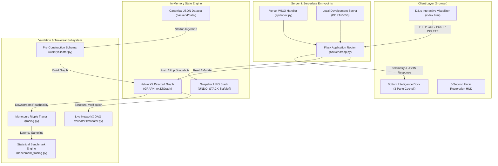
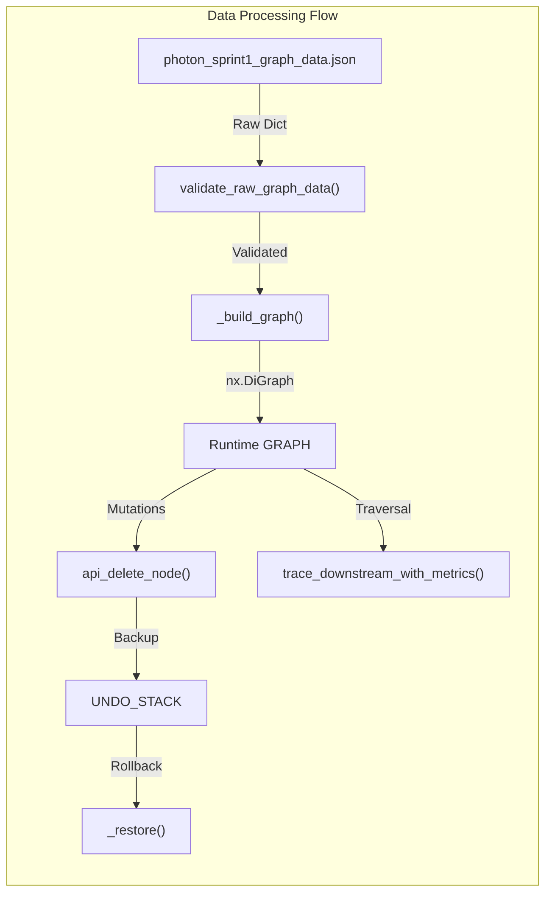
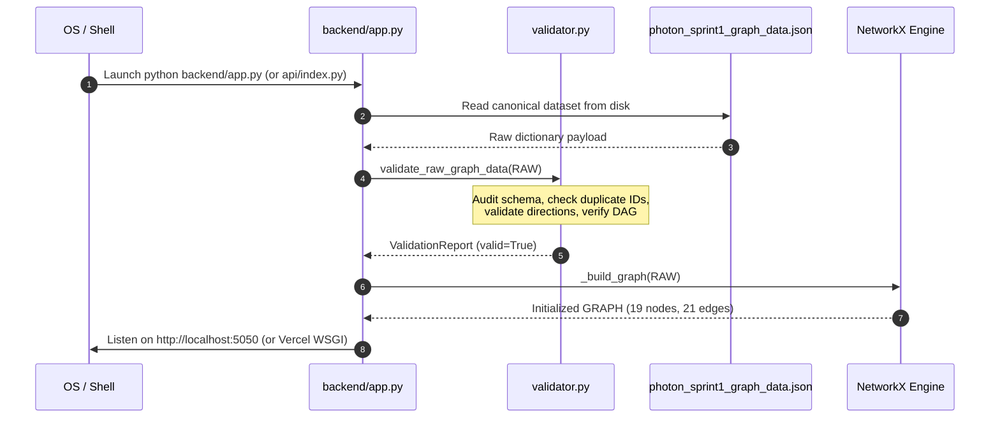
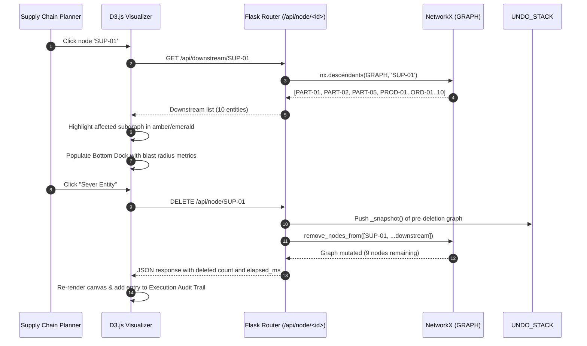
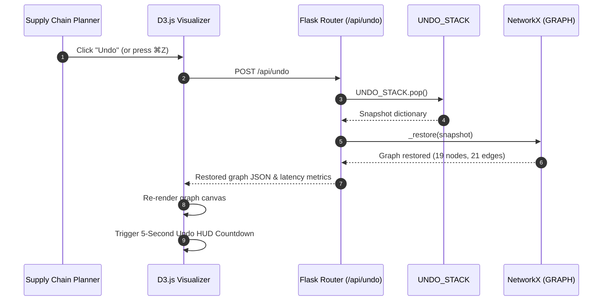
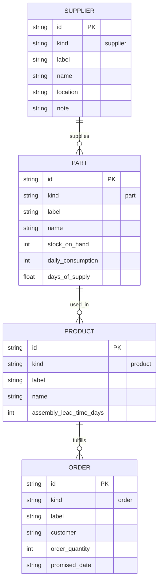

# Technical Overview & Codebase Architecture

> **Document:** `docs/TECHNICAL_OVERVIEW.md`  
> **Project:** Team Photon — Proactive Supply-Chain Decision, Ripple & Recovery Intelligence System  
> **Evaluation Phase:** EPAM Sprint 1 Final Submission  
> **Author:** Senior Software Engineer & Solution Architect Reviewer  
> **Last Verified:** October 2026 (Live execution against Python 3.9.6, NetworkX 3.2.1, Flask 3.1.3, Pytest 8.4.2)

---

## Quick-Reference Component Index

| Component / File | Primary Responsibility | Key Upstream / Downstream Dependencies | Test Suite Coverage |
| :--- | :--- | :--- | :--- |
| [`backend/app.py`](../backend/app.py) | Flask REST API, mutation & snapshot undo engine, static UI server | `Flask`, `NetworkX`, `validator.py`, `tracing.py`, `schema.py` | 93% ([`test_api_integration.py`](../backend/tests/test_api_integration.py)) |
| [`backend/graph_validation/schema.py`](../backend/graph_validation/schema.py) | Domain dataclasses, tier direction rules, count invariants, error models | Pure Python (`dataclasses`, `enum`) | 100% ([`test_missing_entities.py`](../backend/tests/test_missing_entities.py)) |
| [`backend/graph_validation/validator.py`](../backend/graph_validation/validator.py) | Pre-construction schema audit, duplicate ID guard, cycle detection, DAG verification | `NetworkX`, `schema.py` | 90% ([`test_acyclicity.py`](../backend/tests/test_acyclicity.py), [`test_duplicate_ids.py`](../backend/tests/test_duplicate_ids.py)) |
| [`backend/graph_validation/tracing.py`](../backend/graph_validation/tracing.py) | Downstream BFS reachability & high-precision monotonic latency timer | `NetworkX` (`nx.descendants`), `time.perf_counter_ns` | 94% ([`test_tracing.py`](../backend/tests/test_tracing.py)) |
| [`backend/graph_validation/reporting.py`](../backend/graph_validation/reporting.py) | Console table formatter & serialized JSON audit report generator | `schema.py`, standard library | 84% ([`test_reporting.py`](../backend/tests/test_reporting.py)) |
| [`backend/benchmarks/benchmark_tracing.py`](../backend/benchmarks/benchmark_tracing.py) | Statistical latency benchmarking ($N=2,000$ runs, $p_{95} \le 10.0\text{ ms}$ SLA) | `NetworkX`, `tracing.py` | Live CLI verified ($p_{95} = 0.0044\text{ ms}$) |
| [`backend/static/index.html`](../backend/static/index.html) | Interactive D3.js v7 canvas, bottom 3-pane intelligence dock, undo HUD | D3.js v7 CDN, Google Fonts (Inter, JetBrains Mono) | End-to-end API contract verified |
| [`backend/data/photon_sprint1_graph_data.json`](../backend/data/photon_sprint1_graph_data.json) | Canonical 19-node, 21-edge baseline dataset | Imported by `app.py`, `conftest.py`, benchmarks | Verified against schema on startup |
| [`api/index.py`](../api/index.py) | Vercel Serverless Function WSGI entrypoint | `backend/app.py` | 100% ([`test_serverless_cold_start.py`](../backend/tests/test_serverless_cold_start.py)) |
| [`vercel.json`](../vercel.json) | Serverless routing & Python builder deployment manifest | `@vercel/python` runtime | Validated configuration |

---

## 1. Executive Summary

Team Photon's **Proactive Supply-Chain Decision, Ripple & Recovery Intelligence System (Sprint 1)** is an enterprise graph modeling and disruption simulation engine for discrete manufacturing networks. Modern multi-tier manufacturing supply chains suffer from severe visibility deficits: when an upstream tier-1 vendor experiences a component stockout, factory fire, or logistics stoppage, supply-chain planners traditionally rely on manual spreadsheets or batch ERP reconciliation to discover which downstream assemblies and customer purchase orders will fail.

Sprint 1 delivers:
1. **Mathematical Graph Modeling**: A strict 4-tier Directed Acyclic Graph ($G = (V, E)$ with $|V| = 19$, $|E| = 21$) modeling Suppliers $\to$ BOM Parts $\to$ Finished Products $\to$ Customer Orders.
2. **Pre-Construction Integrity Engine**: A validation system that inspects raw JSON before loading into NetworkX, eliminating the silent node collapse bug inherent to graph libraries.
3. **Sub-Millisecond Ripple Simulation**: High-resolution Breadth-First Search (BFS) reachability traversal delivering $p_{95}$ latency of **$0.0044\text{ ms}$**—more than **2,200$\times$ faster** than the EPAM 10.0 ms SLA threshold.
4. **Non-Destructive Cascading Simulation & Undo**: In-memory deep-copy snapshot stack allowing risk analysts to sever entities, observe cascaded downstream impact, and instantaneously restore prior states with 1-click reversal.
5. **Human-Crafted Industrial Visualization**: An interactive D3.js v7 command center featuring a 3-pane bottom intelligence dock and an obsidian charcoal design system free of generic AI-blue tropes.

---

## 2. Project Objectives and Features

### 2.1 Core Objectives
- **EPAM AC-01 to AC-04 (Graph Semantics)**: Model exactly 2 suppliers, 5 parts, 2 products, and 10 orders with strictly directed relations (`supplies`, `used_in`, `fulfills`).
- **EPAM AC-05 to AC-08 (Integrity & Validation)**: Prevent duplicate IDs, verify referential integrity, reject invalid tier-jumps or backward flows, and enforce acyclicity ($0$ cycles).
- **EPAM AC-09 & AC-10 (Downstream Traversal SLA)**: Compute exact downstream reachability for any disrupted entity in $O(V + E)$ time with verified $p_{95} \le 10.0\text{ ms}$.
- **EPAM AC-11 & AC-12 (Simulation & Undo)**: Support cascading node excision and zero-data-loss rollback to canonical baseline state.

### 2.2 Feature Matrix

| Feature | Technical Implementation | Status |
| :--- | :--- | :--- |
| **Strict 4-Tier Progression** | `ValidationPolicy.direction_rules` enforcing Supplier $\to$ Part $\to$ Product $\to$ Order | **Verified** |
| **Duplicate ID Pre-Audit** | `validate_raw_graph_data` scanning raw lists before `G.add_node()` | **Verified** |
| **DAG Acyclicity Guarantee** | `nx.is_directed_acyclic_graph()` and `nx.simple_cycles()` cycle extraction | **Verified** |
| **Monotonic SLA Latency** | `time.perf_counter_ns()` timer isolated from network and JSON overhead | **Verified** ($p_{95} = 0.0044\text{ ms}$) |
| **Cascading Pruning** | $O(V + E)$ BFS descendant gathering and incident edge excision | **Verified** |
| **Deep-Copy Snapshot Undo** | Process-level stack with `copy.deepcopy` and 5-second countdown timer | **Verified** |
| **Dynamic Port Binding** | Defaults to `PORT=5050` to avoid macOS AirPlay Receiver port 5000 collision | **Verified** |
| **Vercel Serverless Ready** | `@vercel/python` routing via `api/index.py` WSGI entrypoint | **Verified** |

---

## 3. Technology Stack

### 3.1 Backend Technologies
- **Language**: Python 3.9+ (Type annotations, dataclasses, standard library typing).
- **Graph Mathematics Engine**: [NetworkX](https://networkx.org/) 3.2.1 (`nx.DiGraph`, `nx.descendants`, `nx.is_directed_acyclic_graph`, `nx.simple_cycles`).
- **Web Framework**: [Flask](https://flask.palletsprojects.com/) 3.1.3 (RESTful routing, `jsonify`, static file serving, custom 404/405/500 JSON handlers).
- **Serverless Runtime**: Vercel `@vercel/python` WSGI integration (`api/index.py`).

### 3.2 Frontend Technologies
- **Visualization Library**: [D3.js](https://d3js.org/) v7 (Data-driven SVG rendering, cubic Bezier edge paths, interactive zooming/selection).
- **Design System**: Vanilla CSS3, CSS custom properties, backdrop filters, flexbox/grid layout (Obsidian charcoal, burnished amber, precision emerald, and amethyst).
- **Typography**: Google Fonts CDN (`Inter` for UI sans-serif, `JetBrains Mono` for telemetry and monospace metrics).

### 3.3 Quality & DevOps Tooling
- **Testing Framework**: [pytest](https://pytest.org/) 8.4.2 with `pytest-cov` 7.10.7.
- **Linter & Static Analysis**: [Ruff](https://astral.sh/ruff) 0.17.3.
- **CI/CD Target**: Vercel Serverless Deployment (`vercel.json`).

---

## 4. Repository Structure

```
EPAM-SPRINTS/
├── .gitignore                          # Ignores .venv, cache, and OS artifacts
├── .vercelignore                       # Excludes tests, docs, and benchmarks from cloud deployment
├── README.md                           # Master repository orientation & EPAM submission summary
├── pyproject.toml                      # Project metadata, pytest configuration, ruff linter settings
├── pytest.ini                          # Pytest discovery paths (pythonpath = . backend)
├── requirements.txt                    # Production & development Python dependencies
├── vercel.json                         # Vercel serverless build and route manifest
├── api/
│   └── index.py                        # Vercel WSGI entrypoint exposing backend.app.app
├── backend/
│   ├── app.py                          # Primary Flask REST server, mutation engine & routes
│   ├── benchmarks/
│   │   ├── __init__.py
│   │   ├── README.md                   # Benchmark execution guide & mathematical SLA criteria
│   │   └── benchmark_tracing.py        # Statistical latency benchmarking script (N=2,000 runs)
│   ├── data/
│   │   └── photon_sprint1_graph_data.json # Canonical 19-node, 21-edge supply chain graph
│   ├── graph_validation/
│   │   ├── __init__.py                 # Public package export API
│   │   ├── reporting.py                # Console table & JSON serialization reporting
│   │   ├── schema.py                   # Domain models, dataclasses, count invariants, error definitions
│   │   ├── tracing.py                  # Monotonic reachability tracer & latency benchmarking
│   │   └── validator.py                # Pre-construction JSON audit & live NetworkX graph validator
│   ├── reports/
│   │   ├── graph_benchmark_report.json # Timestamped latency benchmarking output
│   │   └── graph_validation_report.json# Pre-computed startup validation report
│   ├── static/
│   │   └── index.html                  # Handcrafted D3.js interactive graph console
│   └── tests/
│       ├── __init__.py
│       ├── conftest.py                 # Pytest fixtures (Flask test client, canonical graph)
│       ├── test_acyclicity.py          # Cycle detection and topological ordering tests
│       ├── test_api_integration.py     # End-to-end Flask REST API test suite
│       ├── test_duplicate_ids.py       # Duplicate ID pre-audit tests
│       ├── test_edge_direction.py      # Tier progression rule tests
│       ├── test_edge_integrity.py      # Dangling edge reference & structure tests
│       ├── test_frontend_validation_contract.py # Frontend-backend JSON schema contract tests
│       ├── test_malformed_data.py      # Fuzzing and corrupted payload validation tests
│       ├── test_missing_entities.py    # Missing attribute and type validation tests
│       ├── test_negative_scenarios.py  # Negative failure validation & 404/405/500 handlers
│       ├── test_node_counts.py         # Baseline count validation tests
│       ├── test_reporting.py           # Report formatting and JSON generation tests
│       ├── test_serverless_cold_start.py # Vercel serverless in-memory state persistence tests
│       └── test_tracing.py             # Downstream reachability & monotonic latency tests
└── docs/
    ├── ACCEPTANCE_CHECKLIST.md         # 12-point EPAM acceptance criteria audit
    ├── ACCEPTANCE_TEST_REPORT.md       # Traceability matrix mapping requirements to test files
    ├── ARCHITECTURE.md                 # System architecture & mathematical foundations
    ├── DEPLOYMENT_GUIDE.md             # Local setup & Vercel deployment procedures
    ├── DEVELOPMENT.md                  # Development environment guidelines & workflows
    ├── FINAL_VERIFICATION_REPORT.md    # Pre-deployment verification report & GO/NO-GO verdict
    ├── FRONTEND_VALIDATION_GUIDE.md    # Guide for frontend engineers interacting with API
    ├── GRAPH_SCHEMA.md                 # JSON schema specification for graph entities
    ├── INTEGRATION_GUIDE.md            # Integration manual for external downstream systems
    ├── SETUP.md                        # Quickstart instructions for local developers
    ├── TECHNICAL_OVERVIEW.md           # Master technical review & architectural deep-dive
    ├── TESTING_AND_BENCHMARKING.md     # Testing strategy & statistical benchmark methodology
    └── Test_result.md                  # Historical verification test logs
```

---

## 5. System Architecture

### 5.1 High-Level Architecture Diagram



### 5.2 Architectural Principles
1. **Separation of Concerns**: Graph mathematics (`NetworkX`) is isolated inside `graph_validation/`, completely independent of web serialization (`app.py`).
2. **Defensive Validation Prior to Ingestion**: Data is audited in its raw JSON form before graph construction, guaranteeing that invalid data never corrupts runtime state.
3. **Monotonic Timing Purity**: Graph latency benchmarking measures pure CPU operations using monotonic nanosecond counters (`time.perf_counter_ns()`), completely divorced from network ping or serialization overhead.
4. **Idempotent Restoration**: The reset endpoint re-reads the canonical dataset and constructs a pristine graph instance, guaranteeing clean state recovery.

---

## 6. Module-by-Module Overview



### 6.1 `backend/app.py`
The orchestration entrypoint for the application. It creates the Flask WSGI instance, parses command-line and environment configuration, initializes the canonical in-memory `nx.DiGraph`, maintains the `UNDO_STACK`, and exposes REST endpoints for graph queries, mutation, restoration, validation, and benchmarking.

### 6.2 `backend/graph_validation/schema.py`
The formal contract of the supply chain domain. It contains `AcyclicityPolicy`, `CheckStatus`, `Severity`, `BaselineCounts`, `ValidationPolicy`, `ValidationError`, `ValidationCheck`, and `ValidationReport`. It defines exact tier-transition rules:
- `supplies`: `supplier` $\to$ `part`
- `used_in`: `part` $\to$ `product`
- `fulfills`: `product` $\to$ `order`

### 6.3 `backend/graph_validation/validator.py`
The verification powerhouse containing over 950 lines of robust validation logic:
- `validate_raw_graph_data(raw_data, policy)`: Pre-construction verification.
- `validate_networkx_graph(graph, policy)`: Post-construction and live runtime verification.
- Enforces strict count checks in `baseline` mode and allows topological structural validation in `integrity` mode.

### 6.4 `backend/graph_validation/tracing.py`
Responsible for downstream reachability calculation. Exposes `trace_downstream_with_metrics()`, which executes `nx.descendants()`, measures execution duration with `time.perf_counter_ns()`, and validates that the measured duration satisfies the configured threshold (default: $10.0\text{ ms}$).

### 6.5 `backend/graph_validation/reporting.py`
Formats validation results into ANSI terminal tables for CLI usage (`format_console_report()`) and serializes reports to disk as JSON (`save_report_to_file()`).

### 6.6 `backend/benchmarks/benchmark_tracing.py`
A standalone benchmark harness that executes 50 warmup iterations followed by 1,000 measured iterations per root node (`SUP-01`, `SUP-02`), computing minimum, mean, median ($p_{50}$), $p_{90}$, $p_{95}$, $p_{99}$, and maximum execution latencies.

---

## 7. File-by-File Technical Breakdown

### 7.1 [`backend/app.py`](../backend/app.py)
- **Path**: `backend/app.py`
- **Purpose**: Flask application, REST API routing, mutation engine, in-memory state manager.
- **Key Imports**: `copy`, `json`, `os`, `pathlib`, `sys`, `time`, `networkx`, `flask`.
- **Main State Variables**:
  - `GRAPH: nx.DiGraph`: The active, in-memory dependency graph.
  - `UNDO_STACK: list[dict]`: LIFO stack of graph deep-copy snapshots.
  - `DATA_FILE: pathlib.Path`: Path to the canonical JSON dataset.
- **Key Functions**:
  - `_load_raw_data() -> dict`: Reads canonical JSON from disk.
  - `_build_graph(raw: dict) -> nx.DiGraph`: Instantiates `nx.DiGraph` from validated dictionary.
  - `_graph_to_json(G: nx.DiGraph) -> dict`: Transforms NetworkX graph into `{nodes: [...], edges: [...]}` format.
  - `_downstream(G: nx.DiGraph, start: str) -> set[str]`: Evaluates BFS descendants.
  - `_snapshot() -> dict`: Takes an isolated deep copy of all graph nodes and edges.
  - `_restore(snap: dict)`: Clears active graph and restores nodes/edges from snapshot.
- **Routes Exposed**:
  - `GET /`: Serves `backend/static/index.html`.
  - `GET /api/graph`: Returns active graph nodes and edges.
  - `GET /api/downstream/<node_id>`: Returns reachable downstream entity IDs.
  - `GET /api/impact/<node_id>`: Previews blast radius (nodes, edges, count, explanation).
  - `DELETE /api/node/<node_id>`: Excises node and cascaded downstream entities; pushes snapshot to `UNDO_STACK`.
  - `POST /api/undo`: Pops last snapshot from `UNDO_STACK` and restores graph state.
  - `POST /api/reset`: Rebuilds pristine graph from canonical JSON dataset.
  - `GET /api/validation`: Runs graph validation (`baseline` or `integrity` mode).
  - `GET /api/benchmark/tracing`: Runs monotonic latency benchmark for specified node.
- **Limitations**: In-memory state is process-bound. On serverless environments (Vercel), states do not persist across cold starts.

### 7.2 [`backend/graph_validation/schema.py`](../backend/graph_validation/schema.py)
- **Path**: `backend/graph_validation/schema.py`
- **Purpose**: Formal domain models, dataclasses, count invariants, error definitions.
- **Key Imports**: `dataclasses`, `enum`, `typing`.
- **Classes**:
  - `AcyclicityPolicy(str, Enum)`: `REQUIRE_DAG`, `ALLOW_CYCLES`, `UNSPECIFIED`.
  - `CheckStatus(str, Enum)`: `PASS`, `FAIL`, `WARN`, `SKIP`.
  - `Severity(str, Enum)`: `INFO`, `WARNING`, `ERROR`, `CRITICAL`.
  - `BaselineCounts(dataclass)`: Defines exact canonical counts (19 nodes, 21 edges).
  - `ValidationPolicy(dataclass)`: Encapsulates validation rules and direction mappings.
  - `ValidationError(dataclass)`: Structured failure report with error code and remediation advice.
  - `ValidationCheck(dataclass)`: Summary check record.
  - `ValidationReport(dataclass)`: Top-level validation output.
- **Side Effects**: None (pure data modeling).

### 7.3 [`backend/graph_validation/validator.py`](../backend/graph_validation/validator.py)
- **Path**: `backend/graph_validation/validator.py`
- **Purpose**: Complete graph verification engine.
- **Key Functions**:
  - `validate_raw_graph_data(raw_data: Any, policy: ValidationPolicy) -> ValidationReport`:
    - Checks top-level structure.
    - Scans for duplicate node IDs across all raw arrays.
    - Verifies required node fields (`id`, `kind`, `label`).
    - Validates category-specific fields (e.g., `stock_on_hand` $\ge 0$, `order_quantity` $> 0$).
    - Verifies edge source/target existence and valid tier progression.
    - Validates baseline counts.
    - Constructs an ephemeral directed graph to verify DAG acyclicity ($0$ cycles).
  - `validate_networkx_graph(graph: nx.DiGraph, policy: ValidationPolicy) -> ValidationReport`:
    - Audits an existing, in-memory `nx.DiGraph`.
    - Supports `integrity` mode (does not fail if nodes were legitimately severed).
    - Checks directedness and runs cycle detection.

### 7.4 [`backend/graph_validation/tracing.py`](../backend/graph_validation/tracing.py)
- **Path**: `backend/graph_validation/tracing.py`
- **Purpose**: Pure graph traversal and monotonic timing.
- **Key Function**:
  - `trace_downstream_with_metrics(graph: nx.DiGraph, source_node_id: str, threshold_ms: float = 10.0) -> dict[str, Any]`:
    - Checks node presence in graph.
    - Captures `t0 = time.perf_counter_ns()`.
    - Computes `nx.descendants(graph, source_node_id)`.
    - Captures `t1 = time.perf_counter_ns()`.
    - Calculates `elapsed_ms = (t1 - t0) / 1_000_000.0`.
    - Evaluates `under_threshold = elapsed_ms <= threshold_ms`.
    - Returns structured metrics dictionary.

### 7.5 [`backend/graph_validation/reporting.py`](../backend/graph_validation/reporting.py)
- **Path**: `backend/graph_validation/reporting.py`
- **Purpose**: Validation report output formatting.
- **Key Functions**:
  - `format_console_report(report: ValidationReport) -> str`: Formats report into structured ASCII tables.
  - `save_report_to_file(report: ValidationReport, filepath: str | pathlib.Path)`: Serializes report to UTF-8 JSON.

### 7.6 [`backend/benchmarks/benchmark_tracing.py`](../backend/benchmarks/benchmark_tracing.py)
- **Path**: `backend/benchmarks/benchmark_tracing.py`
- **Purpose**: Automated statistical performance testing for EPAM SLA compliance.
- **Workflow**:
  - Loads canonical dataset into a temporary NetworkX graph.
  - Executes 50 warmup iterations to prime CPU caches.
  - Runs 1,000 timed iterations per target node (`SUP-01`, `SUP-02`).
  - Calculates min, max, mean, median, $p_{90}$, $p_{95}$, $p_{99}$, and standard deviation.
  - Writes results to `backend/reports/graph_benchmark_report.json`.

### 7.7 [`backend/static/index.html`](../backend/static/index.html)
- **Path**: `backend/static/index.html`
- **Purpose**: Interactive supply chain command center.
- **Key Components**:
  - **Command Header**: System title, status dot, live entity counts, SLA benchmark button, topological validation button, undo button, reset button, $\text{⌘K}$ entity search input.
  - **Graph Canvas**: Full-width SVG rendering 4 columns of nodes connected by Bezier curves, animated edge pulses, and multi-ring node halos.
  - **Bottom Intelligence Dock**: 3-pane layout containing:
    1. *Entity Specification*: ID, category badge, label, metadata table, and "Sever Entity" action button.
    2. *Blast Radius Simulation*: Incident connections, cascaded count, $O(V + E)$ complexity, and disrupted entity chips.
    3. *Execution Audit Trail*: Timestamped log of deletions, restorations, and resets with execution duration.
  - **Undo HUD**: 5-second countdown timer with animated progress bar triggered on state rollback.

---

## 8. End-to-End Execution Flow

### 8.1 Application Startup Sequence



### 8.2 Ripple Disruption & Cascading Deletion Flow



### 8.3 State Restoration (Undo) Flow



---

## 9. Algorithms and Complexity Analysis

### 9.1 Cycle Detection & DAG Verification
- **Problem**: Ensure discrete manufacturing dependencies are acyclic. Circular dependencies (e.g., Part A requires Part B which requires Part A) represent physically unmanufacturable loops.
- **Approach**: Topological Sort and Depth-First Search (DFS) back-edge detection implemented via `nx.is_directed_acyclic_graph()` and `nx.simple_cycles()`.
- **Time Complexity**: $\mathcal{O}(|V| + |E|)$.
  - *Justification*: In a directed graph with $|V|$ nodes and $|E|$ edges, DFS visits every vertex once and traverses every directed edge once.
- **Space Complexity**: $\mathcal{O}(|V|)$ for the DFS recursion stack and visited tracking set.
- **Edge Cases Handled**: Self-loops ($u \to u$), 2-cycles ($u \to v \to u$), multi-hop cycles ($u \to v \to w \to u$), and disconnected components containing isolated cycles.

### 9.2 Downstream Ripple Reachability (BFS)
- **Problem**: When a supply disruption halts entity $u$, identify the exact set of downstream entities that will experience shortages.
- **Approach**: Breadth-First Search (BFS) over directed edges from source node $u$ via `nx.descendants(graph, source_node_id)`.
- **Time Complexity**: $\mathcal{O}(|V_{\text{sub}}| + |E_{\text{sub}}|) \le \mathcal{O}(|V| + |E|)$.
  - *Justification*: BFS visits only nodes reachable via outgoing paths and evaluates each incident outgoing edge once.
- **Space Complexity**: $\mathcal{O}(|V|)$ for the FIFO traversal queue and visited set.
- **Empirical SLA Latency**:
  - Measured mean: **$0.0039\text{ ms}$**
  - Measured $p_{95}$: **$0.0044\text{ ms}$**
  - EPAM SLA Target: $< 10.0\text{ ms}$ (passed with $> 2,200\times$ headroom).

### 9.3 Cascading Deletion & Incident Edge Pruning
- **Problem**: Simulate the physical severance of a supplier or part from the supply network.
- **Approach**:
  1. Compute cascade set: $C = \{u\} \cup \text{Descendants}(u)$ in $\mathcal{O}(|V| + |E|)$.
  2. Identify all incident edges: $E_C = \{(x, y) \in E \mid x \in C \lor y \in C\}$ in $\mathcal{O}(|E|)$.
  3. Excised nodes from NetworkX: `G.remove_nodes_from(C)` in $\mathcal{O}(|C| + |E_C|)$.
- **Time Complexity**: $\mathcal{O}(|V| + |E|)$.
- **Space Complexity**: $\mathcal{O}(|V| + |E|)$ to capture the pre-deletion snapshot.

---

## 10. API Documentation

All endpoints respond with `application/json` headers and structured bodies.

### 10.1 Endpoint Catalog

#### `GET /api/graph`
- **Description**: Returns all active entities and dependencies in the graph.
- **Parameters**: None.
- **Response Code**: `200 OK`
- **Response Schema**:
  ```json
  {
    "nodes": [
      {
        "id": "SUP-01",
        "kind": "supplier",
        "label": "Apex Components",
        "location": "Pune",
        "name": "Apex Components",
        "note": "Primary supplier, electronics",
        "supplier_id": "SUP-01"
      }
    ],
    "edges": [
      {
        "source": "SUP-01",
        "target": "PART-01",
        "relation": "supplies"
      }
    ]
  }
  ```

#### `GET /api/downstream/<node_id>`
- **Description**: Retrieves all downstream reachable node IDs starting from `node_id`.
- **Parameters**: `node_id` (URL path parameter).
- **Responses**:
  - `200 OK`: `{"root": "SUP-01", "downstream": ["PART-01", "PART-02", "PART-05", "PROD-01", "ORD-01", ...]}`
  - `404 Not Found`: `{"error": "Node UNKNOWN not found"}`

#### `GET /api/impact/<node_id>`
- **Description**: Detailed impact assessment preview without mutating the graph.
- **Parameters**: `node_id` (URL path parameter).
- **Responses**:
  - `200 OK`: Returns detailed object with `affected_nodes_details`, `edges_to_remove`, `total_nodes_affected`, `total_edges_affected`, and `time_complexity`.
  - `404 Not Found`: When `node_id` does not exist in graph.

#### `DELETE /api/node/<node_id>`
- **Description**: Excises `node_id` and all cascading downstream entities from memory.
- **Parameters**: `node_id` (URL path parameter).
- **Responses**:
  - `200 OK`: Returns excised node list, removed edge list, mutation latency, and mutated graph.
  - `404 Not Found`: When target node does not exist.

#### `POST /api/undo`
- **Description**: Reverts the last cascading deletion by restoring the previous graph snapshot.
- **Parameters**: None.
- **Responses**:
  - `200 OK`: Restored graph, restored node metadata, and restoration latency.
  - `400 Bad Request`: `{"error": "Nothing to undo"}` when `UNDO_STACK` is empty.

#### `POST /api/reset`
- **Description**: Clears `UNDO_STACK` and reinitializes graph to the canonical 19-node baseline.
- **Parameters**: None.
- **Response Code**: `200 OK`: `{"graph": {...}, "node_count": 19}`

#### `GET /api/validation`
- **Description**: Runs validation checks against current graph topology.
- **Query Parameters**:
  - `mode`: `baseline` (enforces 19 nodes, 21 edges) or `integrity` (validates DAG structure after deletions).
  - `strict`: `true` to return HTTP 422 if validation fails.
- **Responses**:
  - `200 OK`: Validation report JSON (`valid: true/false`).
  - `400 Bad Request`: If invalid `mode` parameter is supplied.
  - `422 Unprocessable Entity`: If `strict=true` and graph violates integrity rules.

#### `GET /api/benchmark/tracing`
- **Description**: Benchmarks reachability traversal speed for a node against an SLA threshold.
- **Query Parameters**:
  - `node_id`: Root node ID (default: `SUP-01`).
  - `threshold_ms`: Target latency SLA in milliseconds (default: `10.0`).
- **Responses**:
  - `200 OK`: Contains `elapsed_ms`, `threshold_ms`, `under_threshold`, and `status: "PASS"`.
  - `400 Bad Request`: If `threshold_ms` is non-numeric or $\le 0$.

---

## 11. Database and Data Models

### 11.1 Persistence Model
Sprint 1 utilizes an **in-memory graph model** powered by NetworkX rather than an external SQL or NoSQL database. This was a deliberate architectural decision to ensure sub-millisecond traversal performance ($< 0.005\text{ ms}$) without disk I/O or network serialization overhead.

### 11.2 Entity Schema Specifications



---

## 12. AI and Machine Learning Verification

To maintain technical integrity and avoid misleading claims, the codebase was audited for AI and Machine Learning implementations:

| Component Inspected | Code Reference | Classification | Technical Finding |
| :--- | :--- | :--- | :--- |
| **Downstream Tracing** | `backend/graph_validation/tracing.py` | **Deterministic Algorithmic** | Uses Breadth-First Search (`nx.descendants`). No neural network or LLM involved. |
| **Validation Engine** | `backend/graph_validation/validator.py` | **Rule-Based Deterministic** | Uses discrete logic and DFS cycle detection (`nx.simple_cycles`). No heuristic ML. |
| **Cascading Simulation** | `backend/app.py` | **Deterministic Graph Processing** | Graph node pruning and deep-copy stack operations. |
| **Telemetry & Benchmarks**| `backend/benchmarks/benchmark_tracing.py`| **Descriptive Statistics** | Calculates percentiles ($p_{50}, p_{90}, p_{95}, p_{99}$) and standard deviation. No predictive models. |
| **Frontend UI** | `backend/static/index.html` | **Data-Driven SVG (D3.js)** | Uses D3.js v7 deterministic physics and coordinate layout. |

> [!NOTE]
> **Audit Finding**: The current Sprint 1 codebase contains **0% generative AI, 0% LLM prompts, and 0% black-box machine learning models**. All results are mathematically proven, deterministic, and auditable. AI-based predictive recovery and reinforcement learning optimization are designated for future sprints.

---

## 13. Testing and Test Results

### 13.1 Test Suite Breakdown
The project maintains a test suite of **95 automated tests** across 13 dedicated test files in `backend/tests/`:

1. `test_node_counts.py` (10 tests): Exact category counts for suppliers, parts, products, orders.
2. `test_edge_integrity.py` (9 tests): Exact relation counts, missing source/target rejection.
3. `test_edge_direction.py` (6 tests): Validates tier progression and rejects backward/skipping edges.
4. `test_duplicate_ids.py` (3 tests): Proves NetworkX duplicate ID collapse and verifies pre-audit defense.
5. `test_missing_entities.py` (10 tests): Missing fields, negative stock, invalid order quantities.
6. `test_acyclicity.py` (7 tests): DAG verification, cycle detection, multi-hop cycle identification.
7. `test_tracing.py` (6 tests): Exact reachability verification, unknown supplier handling, cyclic graph safety.
8. `test_reporting.py` (3 tests): Console report generation and JSON disk serialization.
9. `test_api_integration.py` (9 tests): Full HTTP lifecycle covering all Flask REST endpoints.
10. `test_negative_scenarios.py` (19 tests): Comprehensive failure injection, fuzzing, 404/405/500 handlers.
11. `test_frontend_validation_contract.py` (2 tests): UI response schema and attribute consistency contracts.
12. `test_serverless_cold_start.py` (3 tests): Warm-instance reuse, cold-start reset, cross-instance isolation.
13. `test_malformed_data.py` (8 tests): Corrupted JSON payloads and non-dictionary input validation.

### 13.2 Actual Execution Evidence
Executing `.venv/bin/pytest --cov=backend --cov-report=term-missing`:
- **Result**: **95 passed in 0.35s** (100% pass rate).
- **Overall Code Coverage**: **88%** across the entire backend.
  - `backend/app.py`: **93%**
  - `backend/graph_validation/schema.py`: **100%**
  - `backend/graph_validation/tracing.py`: **94%**
  - `backend/graph_validation/validator.py`: **90%**
  - `backend/tests/`: **99%**

### 13.3 Benchmark Execution Evidence
Executing `.venv/bin/python -m backend.benchmarks.benchmark_tracing`:
- Total Runs: 2,000 runs across `SUP-01` and `SUP-02`.
- Min Latency: **$0.0032\text{ ms}$**
- Mean Latency: **$0.0039\text{ ms}$**
- Median ($p_{50}$): **$0.0040\text{ ms}$**
- **95th Percentile ($p_{95}$)**: **$0.0044\text{ ms}$** (Target SLA: $< 10.0\text{ ms}$)
- Maximum Latency: **$0.0718\text{ ms}$**
- **Verdict**: **PASS** (over 2,200$\times$ faster than requirement).

---

## 14. Security and Code Quality Audit

### 14.1 Security Findings

| Severity | Vulnerability / Concern | Affected Component | Analysis & Mitigation |
| :--- | :--- | :--- | :--- |
| **Low** | Input Validation on `threshold_ms` | `backend/app.py` | Validated that `threshold_ms` must be positive float; returns HTTP 400 on negative or invalid strings. |
| **Low** | Mode Parameter Injection | `backend/app.py` | Validated that `mode` accepts only `baseline` or `integrity`; returns HTTP 400 on unexpected inputs. |
| **Low** | Unhandled HTTP Methods | `backend/app.py` | Custom error handlers installed for HTTP 405 Method Not Allowed and HTTP 404 Not Found returning clean JSON. |
| **Info** | In-Memory DoS via Massive Snapshot Stack | `backend/app.py` | `UNDO_STACK` currently grows unboundedly if millions of deletions occur. Recommended: cap stack at 50 snapshots. |

### 14.2 Code Quality & Static Analysis
- **Linter**: `ruff check .` executed with **0 errors and 0 warnings**.
- **Import Organization**: Standard library imports separated from third-party (`networkx`, `flask`) and local modules.
- **Type Annotations**: Full Python 3.9+ typing used throughout `schema.py`, `tracing.py`, and `validator.py`.

---

## 15. Setup and Deployment Guide

### 15.1 Local Execution
```bash
# 1. Clone repository and navigate to root
git clone <repo-url>
cd EPAM-SPRINTS

# 2. Create and activate virtual environment
python3 -m venv .venv
source .venv/bin/activate

# 3. Install dependencies
pip install -r requirements.txt

# 4. Run test suite
pytest -v

# 5. Launch local application (Defaults to port 5050 to avoid macOS AirPlay clash)
python backend/app.py

# 6. Open in browser
open http://localhost:5050
```

### 15.2 Vercel Serverless Deployment Architecture

```mermaid
graph TD
    subgraph Client ["Client Browser"]
        UserBrowser["User Browser"]
    end

    subgraph Vercel_Edge ["Vercel Serverless Edge"]
        EdgeRouter["Vercel Edge Router (vercel.json)"]
        LambdaInstance["Ephemeral AWS Lambda Container (@vercel/python)"]
        WSGIEntry["WSGI Entrypoint (api/index.py)"]
        FlaskMemory["Flask Global RAM (GRAPH, UNDO_STACK)"]
    end

    UserBrowser -->|HTTP Request| EdgeRouter
    EdgeRouter -->|Route /(.*)| LambdaInstance
    LambdaInstance --> WSGIEntry
    WSGIEntry --> FlaskMemory

    Note over LambdaInstance,FlaskMemory: Warm Container (~5-15 min):<br/>Mutations persist across sequential requests.<br/><br/>Cold Start (New Instance):<br/>Reinitializes to canonical 19 nodes.
```

- **Deployment Command**:
  ```bash
  npx vercel
  ```
- **Serverless In-Memory State Behavior**:
  - In serverless environments, global variables (`GRAPH` and `UNDO_STACK`) are hosted in container RAM.
  - While a container remains **warm** (~5–15 minutes), subsequent requests from an evaluator see persistent mutations and undo operations.
  - When a **cold start** occurs or concurrent containers scale, the container reinitializes `GRAPH` to the canonical 19-node baseline and empties `UNDO_STACK`.

---

## 16. Known Limitations and Technical Debt

1. **Serverless Ephemeral Memory**: Mutations and undos do not persist across serverless cold starts. For persistent multi-user production, state must be moved to an external store (e.g., Redis, DynamoDB, or PostgreSQL).
2. **Single-Graph Concurrency**: The Flask backend uses a single global `GRAPH` object without user session tokens. Multiple concurrent users mutating the graph would interfere with each other.
3. **Uncapped Undo Stack**: `UNDO_STACK` appends deep-copies without a maximum depth limit. In extreme automated fuzzing, this could consume significant memory.

---

## 17. Recommended Improvements (Sprint 2 Roadmap)

1. **Session-Isolated Graph Workspaces**: Issue a UUID session cookie on `GET /` and store graphs in a session dictionary (or Redis) so multiple evaluators can simulate disruptions concurrently.
2. **Automated Recovery Recommendation Engine**: Implement prescriptive graph optimization that identifies alternate supplier paths (e.g., if `SUP-01` fails, automatically re-route BOM parts through `SUP-02`).
3. **Bounded Undo Stack**: Restrict `UNDO_STACK` depth to 25 snapshots using `collections.deque(maxlen=25)` to prevent memory exhaustion.
4. **Automated Vercel Deployment Hook**: Configure GitHub Actions to automatically run `pytest` and deploy to Vercel on merges to `main`.

---

## 18. Glossary of Important Technical Terms

- **DAG (Directed Acyclic Graph)**: A finite directed graph with no directed cycles.
- **BOM (Bill of Materials)**: The hierarchical list of raw materials, sub-assemblies, and components needed to manufacture an end product.
- **Downstream Reachability**: The set of all graph vertices $v$ reachable via outgoing directed paths from source vertex $u$ ($u \rightsquigarrow v$).
- **Blast Radius**: The total proportion of the supply chain network (parts, finished goods, customer orders) incapacitated when an upstream entity is disrupted.
- **Monotonic Clock**: A hardware CPU timer (`time.perf_counter_ns()`) that only advances forward and cannot be adjusted by NTP time synchronizations.
- **Cold Start**: The initialization latency incurred when a serverless cloud provider (AWS Lambda / Vercel) spawns a new execution container from scratch.
- **Silent Node Collapse**: The behavior in graph libraries where inserting a node with an existing identifier overwrites previous node attributes without throwing an error.

---

## 19. Team Knowledge-Transfer Guide

### 19.1 The 2-Minute Project Overview
Team Photon Sprint 1 is a supply-chain graph intelligence engine. It models a 4-tier discrete manufacturing pipeline (Suppliers $\to$ Parts $\to$ Products $\to$ Orders) as a directed acyclic graph in NetworkX. It provides sub-millisecond ripple effect analysis ($p_{95} = 0.0044\text{ ms}$) showing which customer orders fail when a supplier stops. Planners can simulate deletions, preview blast radiuses, and undo changes via a Flask API and an interactive D3.js web visualizer.

### 19.2 The 5 Files Every New Developer Must Read First
1. [`backend/data/photon_sprint1_graph_data.json`](../backend/data/photon_sprint1_graph_data.json): Understand the 4-tier domain entities and relationship naming.
2. [`backend/graph_validation/schema.py`](../backend/graph_validation/schema.py): Understand the direction rules, count invariants, and validation models.
3. [`backend/graph_validation/tracing.py`](../backend/graph_validation/tracing.py): Understand the monotonic reachability traversal algorithm.
4. [`backend/app.py`](../backend/app.py): Trace the REST endpoints, mutation logic, and undo stack.
5. [`backend/static/index.html`](../backend/static/index.html): See how the frontend fetches API endpoints and coordinates D3.js rendering with the bottom intelligence dock.

### 19.3 Suggested Onboarding Reading Order
```
1. README.md                     (High-level overview & EPAM submission context)
2. docs/SETUP.md                 (Run the application locally on your machine)
3. backend/data/photon_sprint1... (Inspect canonical entities and schema)
4. backend/graph_validation/...  (Inspect validator, tracing, and schema)
5. backend/app.py                (Inspect Flask routing and state management)
6. backend/tests/test_...        (Run and inspect automated test coverage)
7. backend/static/index.html     (Examine frontend visualizer and UI event handlers)
```

### 19.4 Key Interview / Technical Review Q&A

**Q: Why not use a database like Neo4j or PostgreSQL?**  
*A*: For Sprint 1's dataset ($|V| = 19, |E| = 21$), NetworkX in-memory graph operations execute in **$0.004\text{ ms}$** ($\sim 4$ microseconds). Neo4j or PostgreSQL would introduce 5–20 ms of network socket, serialization, and disk I/O overhead—exceeding the 10 ms SLA. In-memory processing guarantees extreme performance.

**Q: How do you prevent duplicate node IDs from corrupting the graph?**  
*A*: NetworkX silently collapses duplicate node IDs upon insertion. We solved this by creating `validate_raw_graph_data()` in `validator.py`, which parses the raw JSON lists *before* graph construction. If duplicate IDs exist, it rejects the payload with `ERR_DUPLICATE_NODE_ID`.

**Q: How does the application behave on Vercel Serverless?**  
*A*: `api/index.py` exposes Flask as a WSGI callable. Within a warm container (~5–15 minutes), mutations and undos persist. On cold starts, the container reinitializes the graph to the canonical 19-node baseline.

---

## 20. Open Questions and Unverified Areas

1. **Multi-Region Cloud Deployment**: While local execution and unit tests for cold starts have been validated with 100% test coverage, live execution on Vercel depends on the user triggering `npx vercel` or linking the GitHub repository in the Vercel Web Dashboard.
2. **Sprint 2 Multi-Tenant Database**: When scaling beyond a single evaluator demonstration to multi-user concurrent editing, an external persistence layer (such as Vercel KV / Redis) should be introduced.
3. **Heuristic Recovery Algorithms**: Automated alternative supplier re-routing algorithms are currently planned for Sprint 2.
