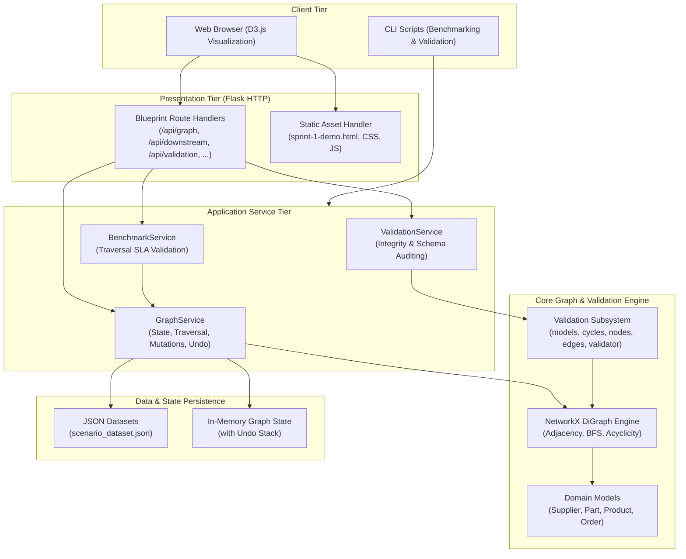

# System Architecture

## Architectural Overview

RE:Flow is designed with a clean, layered architecture separating HTTP transport, domain services, graph algorithms, and data validation. The system relies entirely on Python standard libraries and lightweight open-source dependencies (**Flask**, **NetworkX**, **Pydantic**), ensuring zero external database overhead and sub-millisecond execution times.

---

## Architectural Layers

### 1. Presentation Tier (`backend/app/api/`)
- Encapsulates Flask blueprints registered under the unified `/api` prefix (with `/` serving the visualization UI).
- Enforces HTTP method restrictions, parameter parsing, query validation, and unified JSON error handling (400, 404, 405, 500).

### 2. Service Tier (`backend/app/services/`)
- **`GraphService`**: Central orchestrator managing the active NetworkX graph state, cascading node removals, undo history, downstream reachability analysis, and blast radius calculation.
- **`ValidationService`**: Coordinates data validation runs, selecting between baseline exact count matching and live structural integrity validation.
- **`BenchmarkService`**: Executes parameterized downstream traversal benchmarks, measuring mean, median, p95, and maximum latencies against the 10.0 ms SLA.

### 3. Core Graph Engine (`backend/app/graph/`)
- **`builder.py`**: Converts raw JSON scenario records into a typed `networkx.DiGraph`, instantiating domain models and attaching attributes.
- **`traversal.py`**: Implements high-efficiency Breadth-First Search (BFS) reachability tracing, calculating visited node sets, edge paths, tier breakdowns, and execution metrics.
- **`operations.py`**: Handles cascading node deletion, deep-copy state snapshots, and undo stack rollbacks.

### 4. Validation Subsystem (`backend/app/validation/`)
- Decoupled, modular validation engine:
  - `models.py`: Enums and dataclasses (`ValidationReport`, `ValidationError`, `ValidationPolicy`).
  - `cycles.py`: Acyclicity verification and cycle path resolution using Tarjan/Johnson algorithms.
  - `nodes.py`: Node categorization, unique identifier integrity, and tier attribute enforcement.
  - `edges.py`: Endpoint existence checking, relationship naming, and strict tier progression rules (`Supplier -> Part -> Product -> Order`).
  - `validator.py`: Orchestrator exposing high-level validation entrypoints.
  - `reporting.py`: Terminal formatting and JSON persistence.

### 5. Data & Storage Tier (`backend/app/data/`)
- The canonical supply chain scenario is stored as structured JSON in `backend/app/data/datasets/scenario_dataset.json`.
- Graph state is held in-memory within the Python runtime. Mutations (deletions) modify the in-memory graph directly and push previous states onto an undo stack, allowing instant rollback without database latency.

