# RE:Flow — Sprint 1 Task Execution Plan

> **Sprint**: Sprint 1 — Supply Chain Graph & Scenario Generator  
> **Execution Strategy**: 7-Phase Linear & Parallel Work Breakdown Structure (WBS)  
> **Status**: APPROVED / ACTIVE  

---

## 1. Overview and Execution Principles

To ensure zero blocking bottlenecks, high software quality, and seamless parallel collaboration across the 12 team members, Sprint 1 execution is organized into **7 structured phases**.

RE:Flow's overall system architecture and repository structure were collaboratively designed and discussed by the entire project team. Deep and Divyanshu contributed to architecture coordination and review, while the final architectural decisions reflect collective team discussions and requirements.

Each phase defines:
1. **Responsible Members** (Primary and Supporting).
2. **Files Involved**.
3. **Upstream Dependencies**.
4. **Expected Output**.
5. **Rigorous Completion & Exit Criteria**.

---

## 2. Phase Breakdown

### Phase 1 — Requirements and Data Contracts (COMPLETED)
- **Objective**: Establish Sprint 1 scope, domain model definitions, JSON schemas, serialization contracts, and core configurations before any data or graph logic is written.
- **Responsible Members**:
  - **Primary**: Mishti, Development Team (Implemented by Deep during Sprint 1; Team Maintained)
  - **Supporting**: Anushka, Ansh, Sonal
- **Files Involved**:
  - `docs/sprint/sprint_1.md`
  - `docs/architecture/graph_schema.md`
  - `data/schemas/graph_schema.json`
  - `data/schemas/README.md`
  - `backend/app/models/nodes.py`
  - `backend/app/models/edges.py`
  - `backend/app/models/graph.py`
  - `backend/app/schemas/graph.py`
  - `backend/app/schemas/traversal.py`
  - `backend/app/schemas/validation.py`
  - `backend/app/core/config.py`
  - `backend/app/core/constants.py`
  - `backend/app/core/exceptions.py`
- **Dependencies**:
  - Approved EPAM project specification (19 nodes, 21 directed edges across 4 tiers).
- **Expected Output**:
  - Formal Sprint 1 charter approved by Mishti.
  - Frozen domain models (`SupplierNode`, `BOMPartNode`, `FinishedProductNode`, `CustomerOrderNode`).
  - Frozen edge definitions (`SUPPLIES`, `USED_IN`, `FULFILLS`).
  - Request/response Pydantic/dataclass schemas for `/api/graph`, `/api/traversal`, `/api/validation`.
- **Completion Criteria**:
  - [x] All 4 tier models and 3 edge models defined with complete field types (COMPLETED).
  - [x] JSON Schema validated against Draft-07 specification (COMPLETED).
  - [x] Core constants (`TierType`, `EdgeType`) exported and importable (COMPLETED).
  - [x] Model contract signed off by Ansh, Aadee, and Preetam (COMPLETED).

---

### Phase 2 — Dataset and Data Loading
- **Objective**: Populate the approved baseline scenario dataset, create test fixtures, and build the data loading and normalization layer.
- **Responsible Members**:
  - **Primary**: Anushka, Aadee
  - **Supporting**: Sonal, Deep
- **Files Involved**:
  - `data/raw/scenario_dataset.json`
  - `data/raw/README.md`
  - `backend/tests/fixtures/sample_scenario.json`
  - `backend/tests/fixtures/README.md`
  - `backend/app/data/loader.py`
  - `backend/app/data/normalizer.py`
  - `backend/app/data/repository.py`
  - `docs/reports/mapping_verification.md`
- **Dependencies**:
  - Phase 1 domain contracts and `graph_schema.json`.
- **Expected Output**:
  - Populated canonical scenario dataset (`data/raw/scenario_dataset.json`).
  - Working JSON loader with error handling.
  - Normalization engine producing standardized domain dictionaries.
  - `ScenarioRepository` providing cached in-memory access.
  - Preliminary mapping verification by Sonal.
- **Completion Criteria**:
  - [ ] Dataset strictly contains 2 Suppliers, 5 BOM Parts, 2 Finished Products, 10 Orders (19 nodes, 21 edges).
  - [ ] Relationships verified: Supplier -> Part (`SUPPLIES`), Part -> Product (`USED_IN`), Product -> Order (`FULFILLS`).
  - [ ] `loader.py` parses file successfully without syntax errors.
  - [ ] `normalizer.py` validates all required keys and outputs typed structures.
  - [ ] Sonal verifies 100% edge integrity in `mapping_verification.md`.

---

### Phase 3 — Graph Construction
- **Objective**: Build the NetworkX Directed Graph (`nx.DiGraph`) representation, implement reusable graph operations, and wrap graph lifecycle in `GraphService`.
- **Responsible Members**:
  - **Primary**: Ansh
  - **Supporting**: Deep, Aadee, Anushka
- **Files Involved**:
  - `backend/app/graph/schema.py`
  - `backend/app/graph/builder.py`
  - `backend/app/graph/operations.py`
  - `backend/app/services/graph_service.py`
- **Dependencies**:
  - Phase 2 `ScenarioRepository` and validated dataset.
  - Phase 1 domain models.
- **Expected Output**:
  - Graph construction module (`build_supply_chain_graph()`) creating `networkx.DiGraph`.
  - Node and edge attribute injection (tiers, costs, lead times, quantities).
  - Graph utility functions for node lookups, degree counts, and subgraph extraction.
  - `GraphService` singleton managing application graph state.
- **Completion Criteria**:
  - [ ] `graph.number_of_nodes() == 19` and `graph.number_of_edges() == 21`.
  - [ ] Every node in graph has attached `tier` and attribute dictionary.
  - [ ] Every edge in graph has attached `relationship_type` attribute.
  - [ ] `GraphService` successfully loads dataset on startup and exposes cached graph.

---

### Phase 4 — Traversal and Validation
- **Objective**: Implement downstream BFS impact analysis and comprehensive multi-tier graph validation engines.
- **Responsible Members**:
  - **Primary**: Preetam, Soumya
  - **Supporting**: Divyanshu, Ansh, Deep
- **Files Involved**:
  - `backend/app/graph/traversal.py`
  - `backend/app/services/traversal_service.py`
  - `backend/app/validation/graph_validator.py`
  - `backend/app/validation/schema_validator.py`
  - `backend/app/validation/edge_validator.py`
  - `backend/app/services/validation_service.py`
  - `scripts/validate_graph.py`
  - `docs/reports/validation_report.md`
- **Dependencies**:
  - Phase 3 `GraphService` and populated NetworkX graph instance.
- **Expected Output**:
  - High-performance BFS downstream traversal discovering reachable cascade from any start node.
  - Blast-radius breakdown by tier (impacted BOM parts, products, orders).
  - Topological validator verifying DAG acyclicity and reporting cycles.
  - Schema and edge direction validators.
  - Standalone validation CLI script `scripts/validate_graph.py`.
- **Completion Criteria**:
  - [ ] Traversal from Supplier 1 accurately returns all downstream parts, products, and customer orders.
  - [ ] Unknown node ID raises `NodeNotFoundError`.
  - [ ] Graph validator confirms baseline graph is acyclic (`nx.is_directed_acyclic_graph(G) is True`).
  - [ ] Synthetic cycle injection triggers rule failure and cycle path reporting.
  - [ ] `scripts/validate_graph.py` runs and prints clean passing report.

---

### Phase 5 — API Integration
- **Objective**: Connect domain services to REST API endpoints, wire central router, configure static demo serving, and test HTTP communication.
- **Responsible Members**:
  - **Primary**: Divyanshu, Ansh, Preetam, Soumya, Kanak
  - **Supporting**: Sumit, Shanu
- **Files Involved**:
  - `backend/app/main.py`
  - `backend/app/api/router.py`
  - `backend/app/api/routes/health.py`
  - `backend/app/api/routes/graph.py`
  - `backend/app/api/routes/traversal.py`
  - `backend/app/api/routes/validation.py`
  - `backend/app/api/routes/benchmarks.py`
  - `scripts/run_local.py`
- **Dependencies**:
  - Phase 3 `GraphService`, Phase 4 `TraversalService` & `ValidationService`.
  - Phase 1 request/response schemas.
- **Expected Output**:
  - `GET /api/health` returning 200 OK with server status and graph counts.
  - `GET /api/graph` returning 200 OK with serialized 19 nodes and 21 edges.
  - `POST /api/traversal` accepting start node ID and returning blast radius JSON.
  - `GET /api/validation` returning 200 OK with full audit report.
  - `GET /api/benchmarks` returning 200 OK with latency statistics.
  - Static file routing serving `sprint-1-demo.html` at root `/`.
- **Completion Criteria**:
  - [ ] All 5 endpoints respond with valid HTTP status codes and schemas.
  - [ ] `scripts/run_local.py` boots Flask server cleanly on `http://127.0.0.1:5000`.
  - [ ] Browser access to `http://127.0.0.1:5000/` serves static demo shell.

---

### Phase 6 — Testing and Benchmarking
- **Objective**: Author automated unit, integration, edge-case tests, run micro-benchmarks, and verify the <10ms traversal SLA.
- **Responsible Members**:
  - **Primary**: Shanu, Kanak, Divyanshu
  - **Supporting**: Preetam, Ansh, Soumya
- **Files Involved**:
  - `backend/pytest.ini`
  - `backend/tests/conftest.py`
  - `backend/tests/unit/test_graph.py`
  - `backend/tests/unit/test_traversal.py`
  - `backend/tests/unit/test_validation.py`
  - `backend/tests/unit/test_edge_cases.py`
  - `backend/tests/integration/test_api.py`
  - `backend/app/benchmarks/benchmark_graph.py`
  - `backend/app/benchmarks/benchmark_traversal.py`
  - `backend/app/benchmarks/benchmark_results.py`
  - `backend/app/services/benchmark_service.py`
  - `scripts/run_benchmarks.py`
  - `docs/reports/performance_report.md`
  - `docs/reports/complexity_analysis.md`
- **Dependencies**:
  - Phase 4 traversal & validation implementations.
  - Phase 5 working API endpoints.
- **Expected Output**:
  - Shared Pytest fixtures (`conftest.py`).
  - 100% passing test suite across unit and integration suites.
  - Micro-benchmark suite measuring construction and traversal latency.
  - Formal performance report documenting measured latencies.
  - Formal asymptotic complexity analysis documentation.
- **Completion Criteria**:
  - [ ] `pytest backend/tests` passes 100% of test cases.
  - [ ] Code coverage exceeds 90%.
  - [ ] Downstream BFS traversal latency strictly verified under 10 ms across 1,000 runs.
  - [ ] `scripts/run_benchmarks.py` executes successfully and prints summary table.
  - [ ] `docs/reports/performance_report.md` populated with actual measured hardware metrics.

---

### Phase 7 — Documentation and Demo
- **Objective**: Complete end-to-end user documentation, finalize the static browser demonstration interface, verify Render deployment configuration, and secure Sprint 1 sign-off.
- **Responsible Members**:
  - **Primary**: Sumit, Mishti
  - **Supporting**: Architecture Team, All Members
- **Files Involved**:
  - `README.md`
  - `docs/api/api_documentation.md`
  - `docs/sprint/sprint_1_demo_guide.md`
  - `docs/architecture/system_architecture.md`
  - `docs/architecture/data_flow.md`
  - `backend/app/static/sprint-1-demo.html`
  - `backend/app/static/css/sprint-1-demo.css`
  - `backend/app/static/js/sprint-1-demo.js`
  - `render.yaml`
- **Dependencies**:
  - Working backend APIs from Phase 5.
  - Verified test and benchmark results from Phase 6.
- **Expected Output**:
  - Production-ready root `README.md`.
  - Comprehensive API documentation with request/response schemas and curl examples.
  - Interactive static browser visualization demo rendering 4 tiers and interactive traversal.
  - Step-by-step demo guide for local and Render deployments.
  - Verified `render.yaml` deployment specification.
- **Completion Criteria**:
  - [ ] Browser demo successfully renders all 19 nodes in 4 swimlanes.
  - [ ] Clicking a supplier highlights downstream blast radius and updates summary panel.
  - [ ] Validation badge shows audit pass status from `/api/validation`.
  - [ ] All documentation files reviewed and signed off by Mishti.
  - [ ] Render build and start commands tested and verified.

---

## 3. Sprint 1 Execution Flowchart

```mermaid
flowchart TD
    subgraph P1["Phase 1: Requirements & Data Contracts (COMPLETED)"]
        P1_Req["docs/sprint/sprint_1.md<br/>(Mishti)"]
        P1_Mod["models & schemas<br/>(Implemented by Deep; Team Maintained)"]
        P1_Cfg["core constants & exceptions<br/>(Implemented by Deep; Team Maintained)"]
    end

    subgraph P2["Phase 2: Dataset & Loading"]
        P2_Data["scenario_dataset.json<br/>(Anushka)"]
        P2_Load["loader & normalizer<br/>(Aadee)"]
        P2_Map["mapping_verification.md<br/>(Sonal)"]
    end

    subgraph P3["Phase 3: Graph Construction"]
        P3_Bld["graph/builder.py<br/>(Ansh)"]
        P3_Svc["services/graph_service.py<br/>(Ansh)"]
    end

    subgraph P4["Phase 4: Traversal & Validation"]
        P4_Trav["graph/traversal.py (BFS)<br/>(Preetam)"]
        P4_Val["validation engine<br/>(Soumya)"]
    end

    subgraph P5["Phase 5: API Integration"]
        P5_API["API routes & router<br/>(Divyanshu, Ansh, Preetam, Soumya, Kanak)"]
        P5_Main["backend/app/main.py<br/>(Team Maintained)"]
    end

    subgraph P6["Phase 6: Testing & Benchmarking"]
        P6_Test["pytest unit & integration<br/>(Shanu)"]
        P6_Edge["edge cases & complexity<br/>(Divyanshu)"]
        P6_Bench["benchmarks & <10ms SLA<br/>(Kanak)"]
    end

    subgraph P7["Phase 7: Documentation & Demo"]
        P7_Demo["static UI demo<br/>(Sumit)"]
        P7_Docs["README, API & demo guides<br/>(Sumit)"]
        P7_Signoff["Sprint 1 Sign-Off<br/>(Mishti)"]
    end

    P1 --> P2
    P2 --> P3
    P3 --> P4
    P4 --> P5
    P5 --> P6
    P6 --> P7
```

